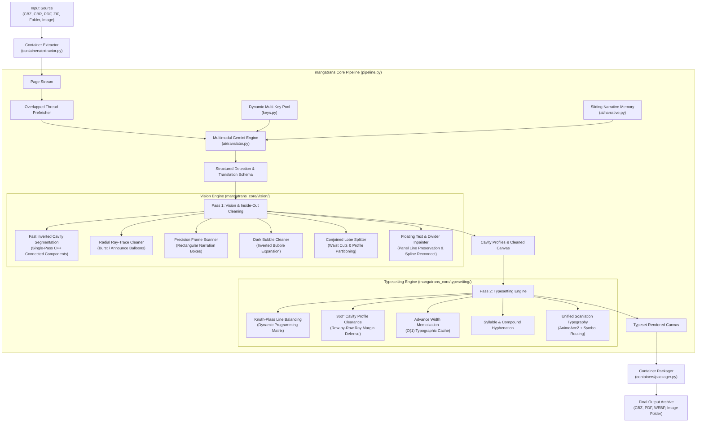

# MangaTrans Architecture & Technical Specification

`mangatrans` is a lightweight, high-performance automated manga and comic scanlation engine. It combines cloud-based multimodal reasoning via the Google Gemini API with local mathematical computer vision (OpenCV) and digital typography (Knuth-Plass dynamic programming line balancing) to translate, inpaint, and typeset manga pages without requiring heavy local neural network weights or dedicated GPU hardware.

---

## 1. High-Level System Architecture



---

## 2. Directory Structure & Module Responsibilities

```
mangatrans/
├── mangatrans                    # Main CLI executable entrypoint
├── ARCHITECTURE.md               # Technical specification and architecture reference
├── README.md                     # User guide, quickstart, philosophy, and options
├── mangatrans_core/              # Core scanlation engine package
│   ├── __init__.py               # Top-level exports and versioning
│   ├── config.py                 # CLI parameters, formats, styling, fonts, progress bars
│   ├── keys.py                   # Multi-key pool, automatic cooldowns, key health testing
│   ├── pipeline.py               # 2-pass orchestrator, overlapped prefetching, resume management
│   ├── ai/
│   │   ├── __init__.py
│   │   ├── narrative.py          # Sliding-window context memory (names, pronouns, honorifics)
│   │   └── translator.py         # Gemini multimodal query builder and structured JSON parser
│   ├── containers/
│   │   ├── __init__.py
│   │   ├── extractor.py          # Safe container extraction (CBZ, CBR, ZIP, PDF, RAR, TAR)
│   │   └── packager.py           # Container assembler (CBZ, PDF, WEBP, folder)
│   ├── typesetting/
│   │   ├── __init__.py
│   │   ├── hyphenation.py        # Syllable splitting, compound words, and glyph advance width memoization
│   │   ├── layout.py             # Knuth-Plass DP line balancing, row-profile clearance, aspect penalties
│   │   └── typography.py         # Unified font routing, casing normalization, and halo outlines
│   └── vision/
│       ├── __init__.py
│       ├── analyzer.py           # Local tonal distribution and Otsu threshold analysis
│       ├── bubble_cleaner.py     # Single-pass cavity segmentation, burst ray-tracing, caption boxes
│       ├── conjoined.py          # Multi-lobe segmentation, waist constriction cuts, reading order
│       ├── floating_cleaner.py   # Floating text inpainting, panel line continuity, Bézier spline bridging
│       └── sfx.py                # Onomatopoeia and SFX preservation filters
```

---

## 3. Multimodal Cloud Intelligence Engine (`mangatrans_core/ai/`)

Rather than requiring users to download 15–30 GB of local PyTorch models requiring dedicated high-end GPUs, `mangatrans` leverages the Google Gemini multimodal API for semantic comprehension:

1. **High-Resolution Visual Context**:
   - The original manga page is transmitted with a structured prompt instructing the model to act as a professional scanlation localization editor.
   - The model inspects text in relation to speaker facial expressions, artistic framing, and reading flow.
2. **Strict Structured JSON Schema**:
   - Each detected dialogue entity returns normalized 1000-scale coordinates (`[ymin, xmin, ymax, xmax]`), original Japanese/Korean/Chinese text, English translation, bubble type (`dialogue`, `thought`, `shout`, `narration`, `whisper`), container classification (`bubble`, `box`, `floating`), and background hint (`white`, `black`).
3. **Sliding-Window Narrative Memory (`narrative.py`)**:
   - Manga is serial narrative art. Translating pages independently leads to erratic gender pronoun swapping (e.g., "he" vs "she") and shifting character names.
   - A sliding window preserves character names, relationships, honorifics, and immediate plot events across consecutive pages, injecting this context into subsequent queries.
4. **Dynamic Key Rotation & Failover (`keys.py`)**:
   - Supports multiple Gemini API keys in a pool.
   - Sequential round-robin cycling maximizes throughput.
   - When a key encounters a rate limit (HTTP 429), it enters an exponential backoff cooldown while execution seamlessly migrates to an alternate healthy key.

---

## 4. Vision & Inpainting Engine (`mangatrans_core/vision/`)

### 4.1 Single-Pass Inverted Connected Components Cavity Segmentation
Earlier iterations utilized 225-seed grid flood-fills across multiple threshold candidate passes (~2,000 OpenCV calls per bubble), which consumed ~35 seconds per page.
The current architecture evaluates cavity boundaries in **3–9 ms** per bubble:
- Dilates the closed outline barrier (`local_border_dilated`).
- Inverts the barrier: non-border pixels form closed cavities.
- Calls OpenCV's C++ `cv2.connectedComponentsWithStats` in a single pass.
- Evaluates bounding box coordinates, areas, and centroid positions directly from component statistics.
- Automatically rejects background components touching the outer region-of-interest boundary.

### 4.2 The 360° Border Defense Invariant
Traditional neural inpainting frequently blurs or obliterates fine speech bubble outlines. `bubble_cleaner.py` enforces a strict mathematical invariant:
$$\text{Cavity} \cap \text{Border} = \emptyset$$
- Edge candidate thresholds ($135 \dots 215$) adapt to local tone and screentone gradients.
- Character strokes within the central text region are identified by solidity and size thresholds, allowing Japanese text inside to be cleaned while preserving surrounding line art.
- The outer outline is dilated by an elliptical structuring element ($5\times 5$ or $7\times 7$), creating an impenetrable barrier that confines the fill strictly within the inner cavity.

### 4.3 Dedicated Radial Burst / Announce Bubble Cleaner (`clean_burst_bubble`)
Announce bubbles have jagged, spiky perimeters that defeat standard morphological closures:
- Computes an aspect-ratio normalized polar coordinate space anchored at the dialogue epicenter.
- Casts radial rays in 360 angular steps to identify the inner boundary envelope.
- Applies Fourier harmonics filtering to track natural spike undulations without clipping linework.
- Cleans interior text via connected component analysis while preserving spiky stroke tips.

### 4.4 Dedicated Rectangular Caption Box Cleaner (`clean_caption_box`)
Narration and editorial boxes require razor-sharp border preservation:
- Employs 4-way directional line scanning from expanded search margins.
- Identifies the top, bottom, left, and right 1-pixel frame lines with 100% precision.
- Cleans the interior right up to the 1-pixel border stroke without erosion or artifacting.

### 4.5 Dedicated Black / Dark Inverted Bubble Processor (`clean_black_bubble`)
- Detects inverted bubbles where white text appears on solid black or dark screentone.
- Segments the dark ink mass using multi-seed connected component expansion.
- Replaces interior pixels with solid black (`[0, 0, 0]`) while automatically configuring white typography (`(255, 255, 255)`).

### 4.6 Panel Line & Divider Continuity Preservation
- Floating text or monologue text positioned between or across comic panels often overlaps solid vertical/horizontal panel borders.
- `detect_panel_line_bounds` scans border columns and rows outside the text zone.
- Reconstructs severed divider lines across inpainted voids using Bézier spline interpolation and stroke-width matching, preventing panel collapse.

### 4.7 Conjoined Multi-Lobe Segmentation & Partitioning (`conjoined.py`)
- When two or more bubbles merge (e.g., conjoined speech lobes):
  - Column and row profile analysis detects structural constriction necks ("waists").
  - Cavities are split along constriction planes into distinct sub-cavities.
  - Sub-cavities are ordered according to natural manga reading order (top-to-bottom, right-to-left).
  - Typesetting envelopes are partitioned along separation boundaries to guarantee zero text collision between adjacent lobes.

---

## 5. Typesetting & Typography Engine (`mangatrans_core/typesetting/`)

### 5.1 Knuth-Plass Dynamic Programming Line Balancing (`dp_balance_lines`)
Traditional greedy line-wrapping creates ugly "ragged" text blocks with awkward dangling single words.
`layout.py` implements a Knuth-Plass dynamic programming formulation:
- Partitions $N$ words across $k$ lines by minimizing total deviation from target line profiles:
  $$\text{Cost} = \sum_{i=1}^k \left( w_i - \text{target\_w}_i \right)^2 + \text{Penalties}$$
- For oval bubbles, target line profiles follow elliptical chord widths, shaping the text into natural diamond or oval blocks.
- For rectangular caption boxes, target widths are uniform.

### 5.2 2D Contour Profile Clearance
- Instead of approximating bubbles with rectangular bounding boxes, the vision pass exports a scanline profile dictionary:
  $$\text{Profile}(y) = [x_{\text{left}}(y), x_{\text{right}}(y)]$$
- Every candidate line at font size $fs$ is checked against the actual 360-degree contour profile across its entire height:
  $$\min(x_{\text{line, left}} - x_{\text{left}}(y), x_{\text{right}}(y) - x_{\text{line, right}}) \ge M$$
- Guarantees that no glyph ever touches or crosses the bubble stroke.

### 5.3 Advance Width Memoization (`_TEXT_LEN_CACHE`)
Evaluating thousands of word combinations across varying font sizes previously invoked PIL FreeType glyph measurements over 128,000 times per page.
An in-memory LRU cache memoizes `(line, font_id, sym_font_id) \rightarrow \text{width}`, dropping typesetting overhead to sub-millisecond speeds.

### 5.4 Unified Professional Scanlation Typography
- Uses standard comic scanlation lettering (`AnimeAce2_Bold.ttf`) uniformly across dialogue, thoughts, shouts, and caption boxes.
- Dynamic Symbol Routing: Non-ASCII scanlation glyphs (hearts `♥`, musical notes `♪`, stars `★`, sweat drops `💧`) are automatically rendered via symbol fallback fonts (`DejaVuSans-Bold` / `NotoSansSymbols2`).
- Floating text over artwork is rendered with a dynamic white halo stroke (`draw_outlined`) to guarantee readability against detailed backgrounds.

---

## 6. Container Extraction, Resumability & Overlapped Prefetching

- **Container Abstraction**: Supports `.cbz`, `.cbr`, `.zip`, `.pdf`, `.rar`, and raw image folders.
- **Overlapped Pipeline Prefetching**: When processing page $N$ (vision and typesetting), the background `ThreadPoolExecutor` concurrently queries Gemini for page $N+1$, hiding network latency.
- **Interruption Recovery**: In-progress translations write incrementally to `.partial.cbz` containers. Rerunning `mangatrans` with `--resume` resumes instantly from the last completed page.
- **Selective Page Retranslation**: The `--pages` and `--retrans` flags allow re-rendering specific pages without reprocessing an entire volume.

---

## 7. Supported Container Formats

| Container Type | Input Support | Output Support | Notes |
| :--- | :---: | :---: | :--- |
| **CBZ (Comic ZIP)** | ✔ | ✔ | Universal open comic standard |
| **ZIP** | ✔ | ✔ | Standard archive packaging |
| **PDF** | ✔ | ✔ | Multi-page raster document |
| **CBR / RAR** | ✔ | ✔ | Output uses `rar` CLI when available |
| **TAR / CBT** | ✔ | ✔ | Standard tarball archive |
| **Image Folders** | ✔ | ✔ | Extracted sequential image directory |
| **Standalone Images** | ✔ | ✔ | WEBP, PNG, JPG, BMP, TIFF |
